# ⚡ VectorForge Web Platform — Complete Technical & Product Specification (PRD)

> **Document Version**: `2.0.0`  
> **Status**: Ready for Implementation  
> **Target Audience**: Core Engineering, Product, UI/UX Design  
> **Author**: Mohamed Ayman (@MikeeeDeV) & Antigravity Autonomous Engineering  
> **Repository**: [github.com/MikeeeDeV/MikeeeDeV](https://github.com/MikeeeDeV/MikeeeDeV)  
> **Product Name**: **VectorForge Studio** (`vectorforge.dev`)

---

## Executive Summary

**VectorForge Studio** is the next-generation web application and creative playground for **VectorForge** — the world's first deterministic, zero-runtime-dependency developer SVG design system and AI-agent manifest engine.

While developer profile generators currently rely on fragile third-party dynamic image APIs (Heroku/Vercel dynos that frequently crash or rate-limit), VectorForge generates **100% self-contained, W3C SVG 1.1 compliant, mathematically deterministic assets**. 

The goal of this web platform is to deliver a **jaw-dropping, developer-first experience** that empowers any developer or autonomous AI agent to:
1. Explore and customize all **235+ developer SVG shapes and presets** across 7 architectural categories.
2. Build a complete, production-grade GitHub profile README in **under 60 seconds** via an interactive visual playground.
3. Integrate native **FastMCP AI Agent tools** into Claude Desktop, Cursor, and Gemini CLI.
4. Experiment with instant client-side GitHub statistics injection without creating personal access tokens.

---

## 🏗️ Recommended Tech Stack & Architectural Foundation

```
┌────────────────────────────────────────────────────────────────────────┐
│                        VECTORFORGE STUDIO STACK                        │
├────────────────────────────────┬───────────────────────────────────────┤
│ Frontend Framework             │ Next.js 15 (App Router) + React 19    │
│ Language                       │ TypeScript 5.5 (Strict Mode)          │
│ Styling & Design Tokens        │ Tailwind CSS v4 + CSS Variables (HSL) │
│ UI Component Primitives        │ Radix UI + Lucide Icons               │
│ Motion & Micro-interactions    │ Framer Motion 11                      │
│ Client State Management        │ Zustand (Playground State Machine)    │
│ Documentation & Content Engine │ MDX with Contentlayer / Velite        │
│ Syntax Highlighting            │ Shiki (Fine-grained dual-theme AST)   │
│ Client-side SVG Processing     │ DOMParser + OffscreenCanvas (PNG exp) │
│ Deployment & Edge CDN          │ Vercel Edge Network / Cloudflare Pages│
└────────────────────────────────┴───────────────────────────────────────┘
```

---

## 🏛️ Comprehensive Sitemap & Core Modules

```mermaid
graph TD
    A["/ (Landing Page / Hero)"] --> B["/showroom (Component Catalog)"]
    A --> C["/builder (Interactive Profile Playground)"]
    A --> D["/docs (Documentation & Getting Started)"]
    A --> E["/ai-hub (FastMCP & Agent Tools)"]
    A --> F["/community (Changelog & Live Visitor Ledger)"]
    
    B --> B1["Category Filters (7 categories)"]
    B --> B2["10 Theme Palettes"]
    B --> B3["Inspector Modal & Exporters (SVG, MD, JSX, PNG)"]
    
    C --> C1["Step 1: GitHub Username Live Fetch"]
    C --> C2["Step 2: Bento Grid Layout Arranger"]
    C --> C3["Step 3: Component Customizer"]
    C --> C4["Step 4: 1-Click README & Workflow Export"]
    
    D --> D1["GitHub Action Setup"]
    D --> D2["Python CLI (pip)"]
    D --> D3["Node.js CLI (npx)"]
    D --> D4["Design Tokens & W3C Specs"]
    
    E --> E1["Claude Desktop & Cursor Configs"]
    E --> E2["Interactive JSON-RPC Sandbox"]
    E --> E3["mcp.json Manifest Explorer"]
    
    F --> F1["Changelog Timeline"]
    F --> F2["Web Terminal Ledger"]
    F --> F3["Designer Contribution Guide"]
```



---

## 1. Landing Page (Hero Section & Value Proposition)

### 1.1 Objectives
Deliver a stunning first impression within **5 seconds**, demonstrating technical credibility, zero-latency rendering, and effortless developer adoption.

### 1.2 Layout & Key Components
1. **Hero Header**:
   - **Headline**: *"The Deterministic SVG Design System for GitHub Profiles & AI Agents"*
   - **Subheadline**: *"Replace brittle third-party badge generators with 235+ mathematically deterministic, zero-runtime-dependency vector components. Built for engineers, tuned for AI agents."*
   - **Primary Action (CTA)**: `[⚡ Launch Profile Builder]` (Deep link to `/builder`).
   - **Secondary Action (CTA)**: `[📦 Copy GitHub Action]` (Copies one-click workflow snippet with tactile clipboard feedback).

2. **Live Interactive Hero Widget**:
   - A real-time, interactive SVG preview rendered directly inside the hero.
   - Allows the visitor to:
     - Type their name or GitHub handle in an inline input.
     - Toggle between 10 high-contrast themes (e.g. *Kemet Nocturne*, *Cyberpunk 2077*, *Nord Frost*).
     - Switch presets on the fly (*Cipher Banner*, *NixOS Neofetch*, *Raft Consensus*, *Visitor Ledger*).
   - **Zero API lag**: The SVG DOM updates instantly client-side without roundtrips.

3. **Technical Feature Grid (Bento Style)**:
   - 🛡️ **Zero External Runtime Dependency**: 100% self-contained vectors. No Heroku or Vercel dyno downtime, ever.
   - 📐 **W3C SVG 1.1 & WCAG 2.1 AA Compliant**: Valid XML with semantic `<title>`, `<desc>`, ARIA roles, and high contrast.
   - 🤖 **FastMCP & Agent Native**: Built-in Model Context Protocol server exposing tool manifests for autonomous AI agents.
   - ⚡ **Multi-Ecosystem Tooling**: Run via GitHub Actions, `pip install vectorforge`, or `npx vectorforge`.
   - 🎨 **10 Curated Aesthetic Palettes**: Tailored color science (Solarized, Dracula, Tokyo Night, Monokai Pro, Rosé Pine).
   - 🪶 **Sub-100KB Guaranteed**: Ultra-compact assets optimized for fast GitHub mobile and web loads.

4. **Quickstart Terminal Snippet**:
   - Tabbed interactive terminal card supporting:
     - `npx vectorforge`
     - `pip install vectorforge`
     - `GitHub Action (uses: MikeeeDeV/MikeeeDeV@v1)`
   - 1-click copy with syntax-highlighted output simulation.

---

## 2. Interactive Showroom (Component Catalog)

### 2.1 Objectives
Provide an ultra-fast, filterable showcase of all **235+ developer components** with real-time theme swapping and instant copy/download workflows.

### 2.2 Category Architecture
The catalog contains 7 formal categories with dedicated layout dimensions:

| Category | Count | Default ViewBox | Description |
| :--- | :---: | :---: | :--- |
| **Banners & Geometric** | `45` | `1200x380` | Seeded cipher banners, astrolabes, Mobius strips, Calabi-Yau manifolds, rosettes. |
| **Terminals (`neofetch`)** | `15` | `820x360` | Hardware/OS fetch terminals for NixOS, Arch, Ubuntu, Debian, macOS, Alpine, etc. |
| **Skylines & Horizons** | `30` | `880x210` | 52-week contribution horizons, Cairo Nile skyline, Tokyo audio equalizer, topo grids. |
| **System Architectures** | `35` | `820x280` | Distributed topology diagrams (Raft, FastMCP Agent Mesh, Istio, Kafka, eBPF). |
| **HUD Badges & Pills** | `35` | `420x88` | Status pills (99.99% SLA, Zero Vulnerability, Rust Memory Safe, Cosign Verified). |
| **Bento & Repo Cards** | `35` | `420x160` | Glassmorphic project cards, cyber frames, minimal syntax tiles, clean architecture. |
| **Holograms & Ledgers** | `25` | `560x240` | Visitor terminal ledgers, quantum radar sweeps, sonar pings, blockchain explorers. |

### 2.3 Search, Filter & Palette Controls
- **Full-Text Instant Search**: Filters components by keyword, ID, title, or category in < 5ms.
- **Global Theme Switcher**: 10 curated themes dynamically applied across the entire catalog:
  1. `kemet_nocturne` (Egyptian Gold & Obsidian)
  2. `cyberpunk_2077` (Neon Yellow & Magenta)
  3. `tokyo_night` (Deep Indigo & Cyan)
  4. `dracula` (Vampire Violet & Pink)
  5. `emerald_matrix` (Cyber Terminal Green)
  6. `nord_frost` (Arctic Blue & Snow White)
  7. `solarized_dark` (Ethan Schoonover Classic)
  8. `monokai_pro` (Technicolor Sublime Accent)
  9. `rose_pine` (Nordic Rosé & Iris)
  10. `amber_crt` (Vintage Phosphor CRT Monitor)

### 2.4 One-Click Action Suite per Component
Each card and inspection modal exposes:
- **`📋 Copy Markdown`**: ``
- **`📦 Copy Raw SVG`**: Sanitized, complete XML string ready for inline embedding.
- **`⚛️ Export React JSX`**: Clean, typed functional component with optional `className` and `fill` props.
- **`💾 Download SVG`**: Downloads `preset-id.svg` directly to the user's filesystem.
- **`🖼️ Export PNG (Social Card)`**: Client-side rasterization via OffscreenCanvas at 2x resolution.

---

## 3. Profile Builder & Playground (The Killer Feature)

### 3.1 Objectives
Transform the user experience from browsing a static repository into an **interactive visual studio** where anyone can design and generate their dream GitHub README in minutes.

### 3.2 Step-by-Step Guided Workflow

```
[ Step 1: Identity ] ➔ [ Step 2: Layout Canvas ] ➔ [ Step 3: Customization ] ➔ [ Step 4: 1-Click Export ]
```

1. **Step 1: Identity & Profile Data**
   - User inputs their GitHub username (e.g. `torvalds` or `MikeeeDeV`).
   - The app fetches public user data directly via GitHub API (`name`, `bio`, `public_repos`, `followers`, `avatar_url`).
   - User can override values (custom display title, primary programming language, current focus).

2. **Step 2: Bento Grid Layout Arranger**
   - Visual drag-and-drop / select interface:
     - **Hero Section**: Cipher Banner, Geometric Rosette, or Animated SMIL Typing.
     - **System Core**: NixOS Neofetch, Arch Terminal, or Quantum Radar.
     - **Telemetry**: 52-Week Nile Horizon Skyline or Contribution Graph.
     - **Architecture Showcase**: Distributed Systems Diagram (FastMCP Mesh, Raft, Microservices).
     - **Project Bento**: 2-column or 3-column repository cards.
     - **Status Badges**: Hardware specs, SLA guarantees, and security shields.
     - **Interactive Terminal Ledger**: Visitor ledger where community members can sign.

3. **Step 3: Component Customization & Live Variable Injection**
   - Live parameter injection sliders and inputs:
     - Change title, subtitle, author handle, and tech stack tags.
     - Theme selector with instant live split-view (Side-by-side Dark / Light mode comparison).

4. **Step 4: 1-Click Export Engine**
   - **Tab 1: `README.md`**: Complete, formatted GitHub Markdown code with perfect whitespace, headers, and accessible alt texts.
   - **Tab 2: `profile-sync.yml`**: Ready-to-commit GitHub Actions workflow file utilizing `MikeeeDeV/MikeeeDeV@v1` to keep the profile fresh on a 6-hour cron schedule.
   - **Tab 3: `vectorforge.json`**: Declarative configuration for users who want to run `vectorforge build` locally.

---

## 4. Documentation & Developer Guide

### 4.1 Objectives
Provide an exhaustive, beautiful technical guide modeled after Stripe and Tailwind docs.

### 4.2 Core Documentation Sections
1. **GitHub Action Setup Guide**:
   - Full workflow copy-paste snippet.
   - Detailed Inputs Matrix:
     - `command`: `generate` vs `build`.
     - `shape`: Preset identifier.
     - `theme`: Theme name override.
     - `output`: Output SVG path.
     - `params`: Dynamic parameter string (`key1=val1,key2=val2`).
   - Security permissions requirement: `permissions: contents: write` explanation.
   - Git Tagging best practice: Always pin `@v1` rather than `@main` for zero-drift determinism.

2. **CLI Guides (Python & Node.js)**:
   - Python:
     ```bash
     pip install vectorforge
     vectorforge search "raft"
     vectorforge generate raft-consensus-cluster --theme kemet_nocturne -o assets/raft.svg
     vectorforge init && vectorforge build
     ```
   - Node.js (Zero-install via NPX):
     ```bash
     npx vectorforge list
     npx vectorforge generate kemet-nocturne-rosette --theme cyberpunk_2077 -o banner.svg
     ```

3. **Design Tokens & W3C Determinism Standard**:
   - Specification of the HSL color palette and mathematical ratio calculations.
   - Rules of deterministic SVG generation:
     - Fixed `viewBox` coordinates without arbitrary scaling.
     - Seeded PRNG algorithms (`xoshiro128+` / `mt19937`) to guarantee that the same commit produces the exact same vector output down to the byte.
     - Zero external CSS or font imports (all fonts use system monospace fallbacks like `Fira Code`, `JetBrains Mono`, `ui-monospace`).

---

## 5. FastMCP & Agentic AI Hub

### 5.1 Objectives
Position VectorForge as the pioneering design system tailored specifically for the **Model Context Protocol (FastMCP)** ecosystem.

### 5.2 FastMCP Integration Showcase
1. **Setup for AI Clients**:
   - **Claude Desktop Configuration** (`claude_desktop_config.json`):
     ```json
     {
       "mcpServers": {
         "vectorforge": {
           "command": "python3",
           "args": ["-m", "vectorforge.mcp_server"]
         }
       }
     }
     ```
   - **Cursor IDE & Gemini CLI integration** steps.

2. **Interactive MCP Tool Inspector**:
   - Live schema viewer documenting exposed tools:
     - `vectorforge_search_shapes`: Query 235 components with semantic keyword filtering.
     - `vectorforge_generate_svg`: Generate SVG strings with theme and variable overrides.
     - `vectorforge_list_themes`: Enumerate available 10 color palettes.
     - `vectorforge_get_catalog`: Fetch full component metadata schema.
   - Built-in in-browser mock runner to execute tool calls and view JSON-RPC responses.

3. **Autonomous Profile Updates**:
   - How background agents can query `mcp.json`, inspect shipping logs, and update developer profile SVGs autonomously.

---

## 6. Changelog & Community Hub

### 6.1 Objectives
Foster community participation, celebrate shipping milestones, and engage visitors directly.

### 6.2 Key Features
1. **Interactive Version Timeline (Changelog)**:
   - Visual release history from `v1.0.0` to present.
   - Diff highlights for new presets, theme additions, and engine performance boosts.

2. **Web Visitor Ledger (Live Interactive Web Terminal)**:
   - An in-browser retro CRT terminal widget.
   - Visitors can type their GitHub username and a 60-character message.
   - **Automated Signing Flow**:
     - Generates a pre-filled GitHub Issue link with the sanitized command:
       `run: sign --user <handle> --message <text>`
     - When submitted, the repo's automated `visitor-terminal.yml` workflow verifies rate limits (24h cooldown), sanitizes the entry, updates `assets/visitor-ledger.svg`, and closes the issue with a `bot-processed` label!

3. **Designer Contribution Guide**:
   - Step-by-step instructions for contributing new SVG presets:
     - Using `library/core/builder.py` and semantic helper methods.
     - Adhering to the < 100KB budget.
     - Running `make test` (28 unit tests).
     - Submitting PRs with automated preview generation.

---

## 💡 Smart & Innovative Features (The Competitive Edge)

To make VectorForge Studio truly exceptional and viral among engineers, the site will incorporate the following advanced capabilities:

### 1. 🧠 AI Natural Language Prompt-to-Profile Customizer
- An input bar where developers can describe themselves:
  > *"I'm a senior Rust & Linux systems architect who builds distributed databases and loves minimalist dark green cyberpunk aesthetics."*
- **The AI Engine** (powered by Gemini / FastMCP reflection) instantly:
  - Selects the `emerald_matrix` theme.
  - Chooses the `Raft Consensus Cluster` architecture shape.
  - Configures the `Linux POSIX Neofetch` terminal.
  - Selects `Memory Safety` and `Zero Vulnerability` badges.
  - Generates the complete, production-ready `README.md` in 1 second!

### 2. ⚡ Client-Side Tokenless GitHub Stats Injection
- Rather than requiring users to authenticate or generate risky personal access tokens, VectorForge fetches public data from `https://api.github.com/users/{username}` client-side.
- The web app dynamically parses the SVG DOM and injects the live stars, commit counts, and repo stats directly into the vector preview in real-time.

### 3. 📐 Interactive Bento Grid Canvas
- Visual layout designer allowing users to resize cards (1x1, 1x2, 2x2 spans) with snap-to-grid alignment.
- Exports mathematically aligned HTML `<table>` or Markdown layout code that renders identically across GitHub Web, GitHub Mobile, and Light/Dark modes.

### 4. 🛡️ SVG Performance, Byte Budget & A11y Auditor
- Real-time audit badge for each component showing:
  - Exact uncompressed byte size (e.g. `4.2 KB`).
  - Gzip / Brotli transfer size.
  - DOM complexity score (node count).
  - WCAG 2.1 Contrast Ratio score (e.g. `7.4:1 AAA Passed`).
  - W3C XML validator status.

### 5. 🚀 1-Click GitHub Repository Template Launch
- A direct intent button: `[🚀 Create Profile Repo with VectorForge]`
- Uses GitHub URL parameters to pre-fill a new profile repository or open a Pull Request directly with the generated `README.md` and `.github/workflows/profile-sync.yml`.

### 6. 📱 Progressive Web App (PWA) with 100% Offline Capability
- Service Worker caching of all 235 SVG assets.
- Allows developers to browse, customize, and export SVGs even while offline or in disconnected development environments.

---

## 🎨 Design System & Visual Aesthetics Specification

```css
/* Core Color Palette Tokens (Tailwind HSL Schema) */
:root {
  /* Kemet Nocturne / Luxury Engineering Obsidian */
  --bg-primary: #0a0c10;
  --bg-card: rgba(18, 22, 31, 0.85);
  --bg-card-hover: rgba(26, 32, 46, 0.95);
  
  /* Brand Accents */
  --accent-gold: #f5c451;
  --accent-cyan: #38bdf8;
  --accent-teal: #14b8a6;
  --accent-purple: #a855f7;
  --accent-rose: #f43f5e;
  
  /* Border & Grids */
  --border-subtle: rgba(255, 255, 255, 0.08);
  --border-accent: rgba(245, 196, 81, 0.35);
  --grid-pattern: radial-gradient(circle, rgba(255, 255, 255, 0.06) 1px, transparent 1px);
  
  /* Typography */
  --font-mono: 'JetBrains Mono', 'Fira Code', ui-monospace, monospace;
  --font-sans: 'Inter', -apple-system, BlinkMacSystemFont, sans-serif;
}
```

### Micro-Interactions & Styling Rules:
1. **Glassmorphism with Fallbacks**: Use `backdrop-filter: blur(16px)` with solid semi-transparent fallbacks for non-WebKit browsers.
2. **Subtle Glow Effects**: Accent elements leverage `box-shadow: 0 0 24px -4px var(--accent-gold-glow)`.
3. **Tactile Copy Animations**: Copying code smoothly morphs the button from `[Copy]` to `[✓ Copied!]` with spring physics via Framer Motion.
4. **Zero Layout Shift (CLS = 0)**: All SVG cards feature strict aspect ratios (`aspect-[1200/380]`, `aspect-[820/360]`, etc.) to prevent layout jumps during lazy loading.

---

## 📅 Phased Implementation Plan

```
Phase 1: Project Initialization & Core Design System
├── Next.js 15 (App Router) + Tailwind CSS v4 setup
├── Design tokens & HSL variable system
└── Ingest 235 SVG catalog & metadata into typed JSON schema

Phase 2: Showroom & Catalog Engine
├── High-performance virtualized grid
├── 7 category tabs & 10 theme dynamic switcher
└── 1-click Exporters (Markdown, Raw SVG, JSX, PNG)

Phase 3: Interactive Profile Playground (Killer Feature)
├── Step-by-step profile builder UI
├── GitHub public data fetcher & live SVG DOM injector
└── Full README.md & GitHub Action workflow exporter

Phase 4: FastMCP AI Hub & Documentation
├── Interactive MCP Tool Inspector & JSON-RPC sandbox
├── Full MDX documentation pages (Action, CLI, Tokens)
└── Claude Desktop / Cursor configuration guides

Phase 5: Community Hub & Launch
├── Interactive Web Visitor Ledger terminal
├── PWA offline caching & SEO optimization
└── Production deployment to Vercel / Cloudflare with custom domain
```

---

## Verification & Acceptance Criteria

- [ ] **Completeness**: All 235 components across 7 categories are browsable, searchable, and exportable.
- [ ] **Determinism**: Every generated SVG validates as 100% compliant W3C XML.
- [ ] **Speed**: Lighthouse Performance score ≥ 98, First Contentful Paint (FCP) < 0.6s.
- [ ] **Zero Crash**: Zero reliance on runtime image generation servers.
- [ ] **Mobile Responsive**: Seamless experience across mobile, tablet, and ultra-wide displays.
- [ ] **Developer Ergonomics**: 1-click copy for Markdown, SVG, and GitHub Action workflow.

---
*VectorForge Studio Specification — Prepared for Mohamed Ayman (@MikeeeDeV)*
